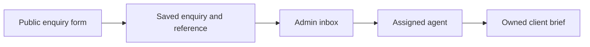

# Dubai Property Developers

## From website enquiry to an owned client brief

**Shah Hussain Bangash · Dubai, UAE**  
**Scope:** Portfolio demonstration of full-stack architecture, a fictional enquiry workflow and separate supplied knowledge for 13 agent identities. Hosted CI, source review and disposable local browser runs provide the evidence below.

[Open the guided screenshot walkthrough](portfolio-demo.html) · [Capability and reproduction guide](PORTFOLIO_CAPABILITIES.md)

### The business problem

A visitor can ask about a property without creating an account. The operations team needs a stable record of the enquiry, its source and the visitor's permission. An approved agent should see only their assignments and should be able to create a client brief once the enquiry has been reviewed.

### My engineering contribution

I separated anonymous intake, admin assignment and agent-owned conversion. I designed the handoff around a saved enquiry reference and a versioned record, so a browser retry can return the same reference and an old staff screen cannot overwrite a newer decision. The conversion operation creates the client brief and links it to the enquiry together.

### One fictional case

| Stage | What the application does |
| --- | --- |
| Intake | A visitor asks about a Dubai Marina apartment, provides example contact details and grants permission for that enquiry. The form submits with a short-lived ticket. |
| Acknowledgement | The visitor receives a reference. Retrying the same ticket returns the existing receipt without changing the record. The acknowledgement stays in the portal. |
| Assignment | An admin opens the shared enquiry inbox and assigns an approved agent using the current record version. |
| Review | The assigned agent checks property interest, budget and permission. Access is removed when approval is revoked. An opted-out, closed or spam enquiry cannot be converted. |
| Conversion | The agent creates a client brief and the portal links it back to the enquiry. Competing conversions leave one owned brief. |

### Architecture and trade-offs

- **Ownership follows authenticated identity.** Matching an email address cannot attach an anonymous enquiry to a member account. Approved agents receive only their own assignments.
- **A reference is operational evidence.** The form shows a receipt after persistence succeeds. Email delivery, CRM synchronization and outbound messaging require separate integration validation.
- **Keep intake and AI assistance independently verifiable.** The product includes a FastAPI workflow layer and optional model adapters. The website-to-client-brief case follows the Next.js enquiry routes and portal store. It demonstrates deterministic controls on the core record handoff.

### What was verified

| Evidence | What it supports |
| --- | --- |
| [Connected enquiry store and handler tests](../../apps/dashboard/src/__tests__/ConnectedEnquiries.test.ts) | Tests cover receipt deduplication, role-scoped visibility, stale edits, revocation, opt-out handling and concurrent conversion using fictional fixtures. |
| [Enquiry UI tests](../../apps/dashboard/src/__tests__/ConnectedEnquiryViews.test.tsx) | Component tests use mocked responses to check consent submission, failure feedback and assignment with the current version. |
| [Candidate browser journey on 26 November 2026](../verification/website-operations-local-2026-11-26.md) | At revision `0d6f4c4`, receipt `DPD-E-3C6AE92E` retained enquiry-only consent and website provenance, became an Alpha-owned brief, and remained invisible to Beta. All 36 focused tests passed. |
| [All-agent knowledge acceptance on 26 November 2026](../verification/all-agent-knowledge-acceptance-local-2026-11-26.md) | At revision `4477bec`, all 13 knowledge scopes passed four-format source checks and 91 browser questions. The API checks cover exact excerpts, page citations, agent/organization exclusion, approval boundaries and removal across restart. |
| [Local browser journey on 24 November 2026](../verification/website-operations-local-2026-11-24.md) | At revision `c3f49e8`, one fictional enquiry retained its consent and source, was assigned to Alpha, and became an Alpha-owned brief. Beta saw neither record. The 36 focused tests passed before and after the run. This is local evidence; hosted staging remains unverified. |
| [Candidate checks](https://github.com/shah-hussain-bangash/dubai-property-developers/pull/87/checks) at revision [`8ea55a8`](https://github.com/shah-hussain-bangash/dubai-property-developers/commit/8ea55a8f512c94add64b066525dae18f5c88c5e5) | All 12 checks passed, including backend/frontend, temporary database integration, Windows setup, security/configuration checks and both container checks. The dashboard check verifies private non-root storage through container replacement. |

[Enquiry implementation notes](../connected_website_enquiries.txt) · [Portal store](../../apps/dashboard/src/lib/agentPropertyStore.ts) · [System architecture](../../ARCHITECTURE.md)

### Portfolio scope and optional follow-up

The captured local journey, synthetic records, screenshots and focused tests are the evidence for this portfolio case. The public demo is available for viewing; it is not evidence that the complete hosted journey has passed.

The Knowledge workspace returns excerpts from assigned material or an explicit no-answer result. These checks do not establish live voice, messaging or CRM delivery, generative answers, or measured business conversion improvements. The [capability guide](PORTFOLIO_CAPABILITIES.md#agent-capabilities) lists functional, partial and interface-only roles separately.

A read-only hosted Admin check on 24 November 2026 found zero registered members, approved agents or access requests. The API identified itself as staging, but the deployed Git revision was not established. No new hosted enquiry or account was created. A future hosted verification would need synthetic operator access and a confirmed deployed revision. Provider delivery and measured conversion improvements remain unverified.
