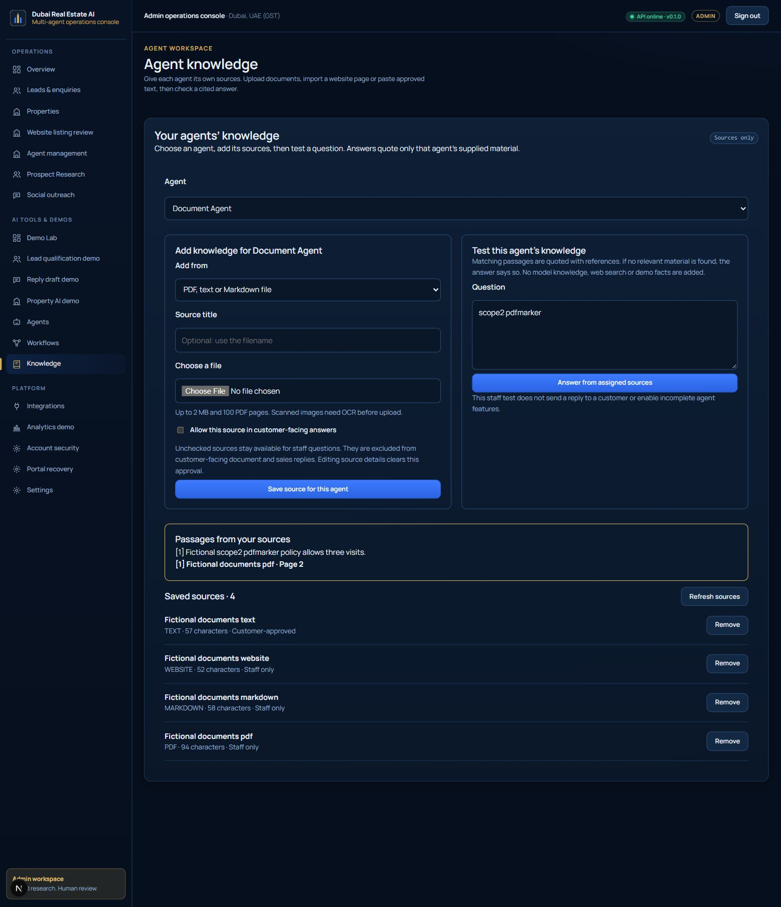

# All agent supplied knowledge acceptance

Local acceptance passed on 26 November 2026 at revision
[`4477bec`](https://github.com/shah-hussain-bangash/dubai-property-developers/commit/4477bec0aef72f2b74d934846f6f8610f9495b30).
All 13 knowledge scopes returned their assigned fictional excerpts and citations,
declined unrelated/foreign questions and stopped answering from removed sources.
No application blocker required a fix.

## Acceptance matrix

Each row covers PDF, Markdown, a mocked website snapshot and pasted text through
the source API and the visible Knowledge page. PDF citations point to page 2.

| Agent | Four cited formats | Agent/organization separation | Approval boundary | Removal and restart |
| --- | --- | --- | --- | --- |
| Supervisor | Pass | Pass | Pass | Pass |
| Lead Intake | Pass | Pass | Pass | Pass |
| Lead Qualification | Pass | Pass | Pass | Pass |
| Property Recommendation | Pass | Pass | Pass | Pass |
| Sales Conversation | Pass | Pass | Pass | Pass |
| Follow-Up | Pass | Pass | Pass | Pass |
| CRM | Pass | Pass | Pass | Pass |
| Email | Pass | Pass | Pass | Pass |
| WhatsApp | Pass | Pass | Pass | Pass |
| Voice AI | Pass | Pass | Pass | Pass |
| Marketing | Pass | Pass | Pass | Pass |
| Document | Pass | Pass | Pass | Pass |
| Analytics | Pass | Pass | Pass | Pass |

These results establish source-management and excerpt-answer behavior for every
registered identity. Routing/scoring agents still use typed rules; the Voice
agent remains interface-only for audio. They do not establish live calls, sending,
CRM synchronization or separately trained models.

## Recorded checks

- **52 sources** imported through authenticated local test APIs: four per agent.
  Source knowledge and question/expected-answer fixtures were stored separately.
- After recreating the app/runtime, **52 exact answers** retained source IDs and
  page references. Missing evidence returned an explicit no-answer response.
- **624 cross-agent** and **52 cross-organization** questions returned no answer.
  All 13 agents also declined the unrelated query.
- For each agent, pasted material was excluded from customer-facing retrieval
  until explicit approval, then became retrievable. Staff preview remained usable.
  This checked retrieval approval, not a customer delivery operation.
- **52 sources removed**, followed by 52 no-answer checks. A second app restart
  confirmed all 13 source lists remained empty.
- The actual browser checked **52 own-format answers**, **13 unrelated questions**,
  **13 foreign-agent questions** and **13 removed-source questions**: **91 questions**.
  Website answers retained their original source URL.
- Existing regression/evaluation runs passed **65 tests** and **47 tests** respectively
  (112 total), including independent per-agent dataset expectations. One existing
  Starlette TestClient/httpx deprecation warning appeared in each run.



[Foreign source not found](assets/knowledge-acceptance-2026-11-26/02-foreign-source-not-found.jpg) ·
[Removed source not found](assets/knowledge-acceptance-2026-11-26/03-removed-source-not-found.jpg) ·
[Per-agent JSON results and screenshot hashes](all-agent-knowledge-acceptance-local-2026-11-26.json).

## Reproduction

Use a new disposable SQLite path and fictional sources only. The source-format
fixture helpers live in tests/security/test_agent_source_format_journey.py;
authenticated manager/viewer/organization fixtures live in
tests/security/test_assigned_source_api_isolation.py. The catalogue's sorted
agent IDs define indices 0–12 for this run.

For agent index N, the two-page PDF's second page contains
`Fictional scopeN pdfmarker policy allows three visits.` Markdown uses
`markdownmarker` and four visits; the public-page fixture uses `webmarker` and two
visits; pasted text uses `pastedmarker` and seven visits. Give each source an
agent-specific title. Use `scopeN <format-marker>` as the question and verify the
exact quoted sentence, source ID and PDF page 2. Another scope's marker and
`quasar telescope zoology` must yield no answer. Never ingest evaluation questions
as source content.

In a local development-only browser workspace connected to that source API,
select each agent, test all four questions, then unrelated and foreign questions.
Remove the sources through the scoped API, recreate the app against the same DB,
refresh the page and repeat the old PDF question. Verify zero sources and no answer.
The existing regression suite is reproducible from the source root:

```text
python -m pytest tests/security/test_agent_source_format_journey.py tests/security/test_assigned_source_api_isolation.py tests/security/test_agent_knowledge_isolation.py tests/security/test_source_bound_approvals.py tests/evaluations -q
python -m pytest tests/agents/test_agent_datasets.py -q
```

## Environment and limits

API boundary checks used the existing fictional token verifier; the browser used
a test-only development principal. This does not verify hosted authentication.
PDF extraction ran in the real subprocess. Website DNS/HTTPS were mocked; no
external page was contacted. Mock integrations and a mock LLM were explicitly
configured. Both services bound to loopback (dashboard 3118, API 8117), with a
fresh portal directory and no inherited application credentials.

The 240 tracked Python runtime files matched candidate Git blob hashes after
line-ending normalization. The browser used the previously pinned dashboard
snapshot; application code is unchanged between its enquiry-acceptance revision
and this documentation candidate.

The browser was signed out, both local services stopped, their ports refused new
connections and the generated plaintext credential was removed. Hosted revision
and test-operator access remain unconfirmed. No merge, deployment, live CRM write,
customer message or production source change occurred.
