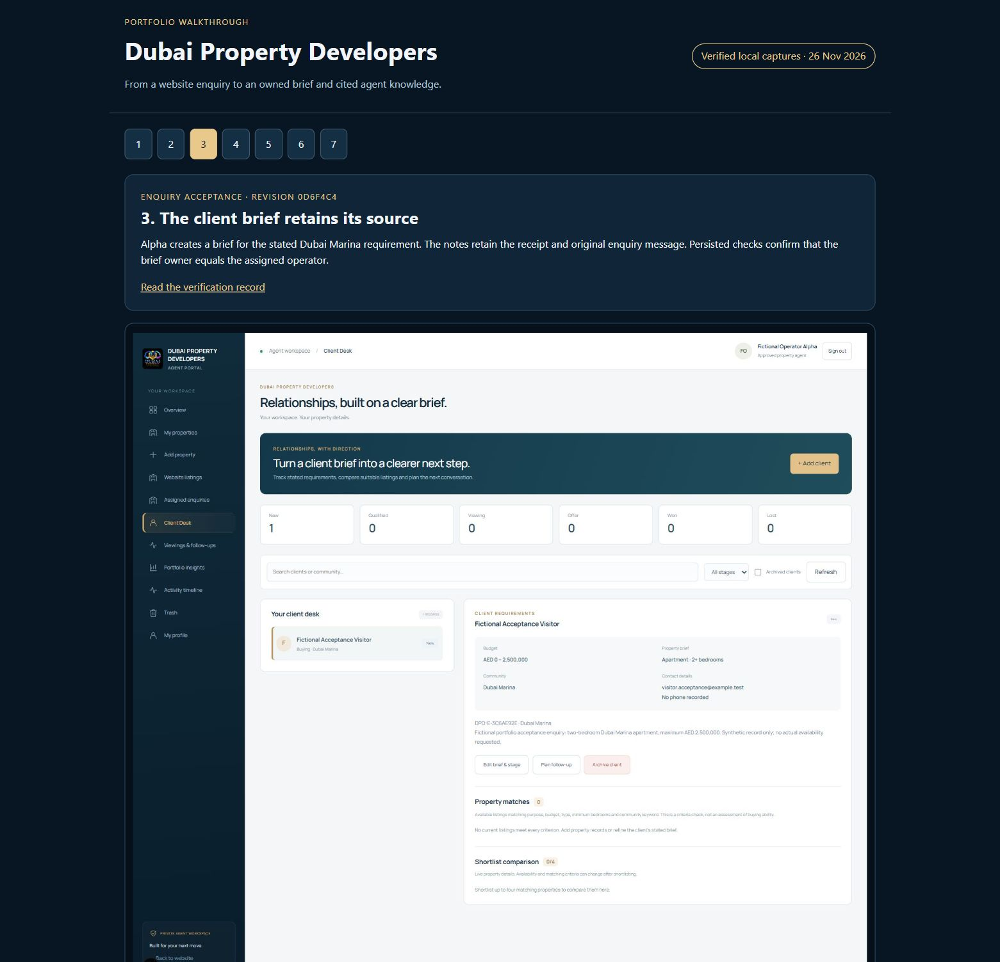

# Portfolio package verification

Verified locally on 26 November 2026, based on parent revision
`8ea55a8f512c94add64b066525dae18f5c88c5e5` plus this documentation package in
[PR 87](https://github.com/shah-hussain-bangash/dubai-property-developers/pull/87).

The package adds a seven-step interactive screenshot walkthrough and a capability
guide, updates the case study to the latest local acceptance records, and links
these materials from README and the completion guide. It does not change
application code, agents, integrations, deployment configuration or saved records.

## Checks and outcomes

- Browser: all seven steps display the intended image/caption/reference. Next,
  Previous and direct numbered selection work; Previous is disabled on step 1
  and Next on step 7. Left-arrow navigation returns from step 7 to step 6.
- Visual review: the client-brief step displays its original evidence capture,
  caption and revision. Full-size image links support closer inspection.
- Assets: all seven referenced JPEG files pass an image-integrity check. The
  local server returned HTTP 200 for all seven during browser navigation.
- Links: static walkthrough links and local Markdown links in the capability
  guide/case study resolve to existing files. External links were retained from
  the verified evidence and repository; they were not exhaustively crawled.
- JavaScript: the extracted inline script passes `node --check`.
- Environment: Python's static server served only docs on 127.0.0.1:3119. It was
  stopped afterward and a connection attempt was refused. No app/API/provider
  process, login or external delivery was needed for the presentation.

The browser review used the desktop viewport. The package is a screenshot
presentation without live screen-recording video or narration.

## Reproduction

Use [the demonstration guide](../case-study/PORTFOLIO_CAPABILITIES.md#open-the-guided-demonstration).
Serve docs locally, move through steps 1–7, check the end boundaries and keyboard
navigation, and open a full-size capture. Every step identifies whether it came
from enquiry revision 0d6f4c4 or knowledge revision 4477bec. This presentation
does not substitute for repeating acceptance on a deployed revision.

Hosted acceptance, complete PR approval, existing-data migration and live-provider
validation remain separate release work. Nothing was merged or deployed.
