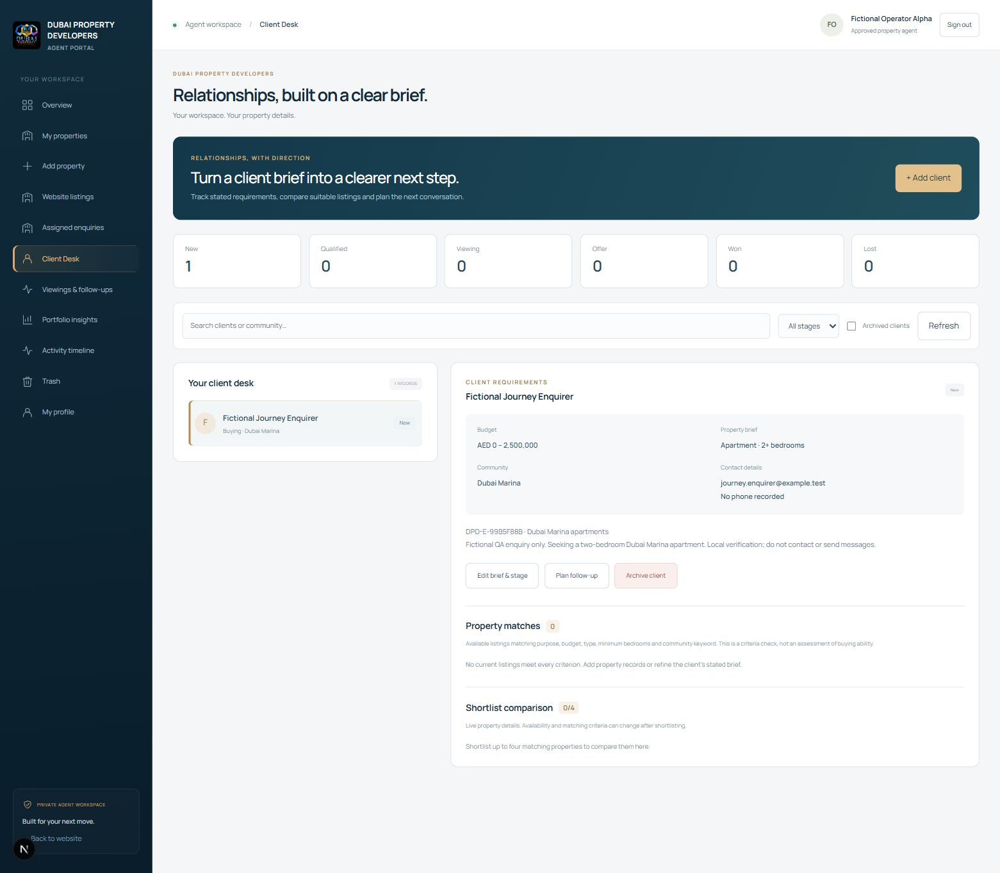
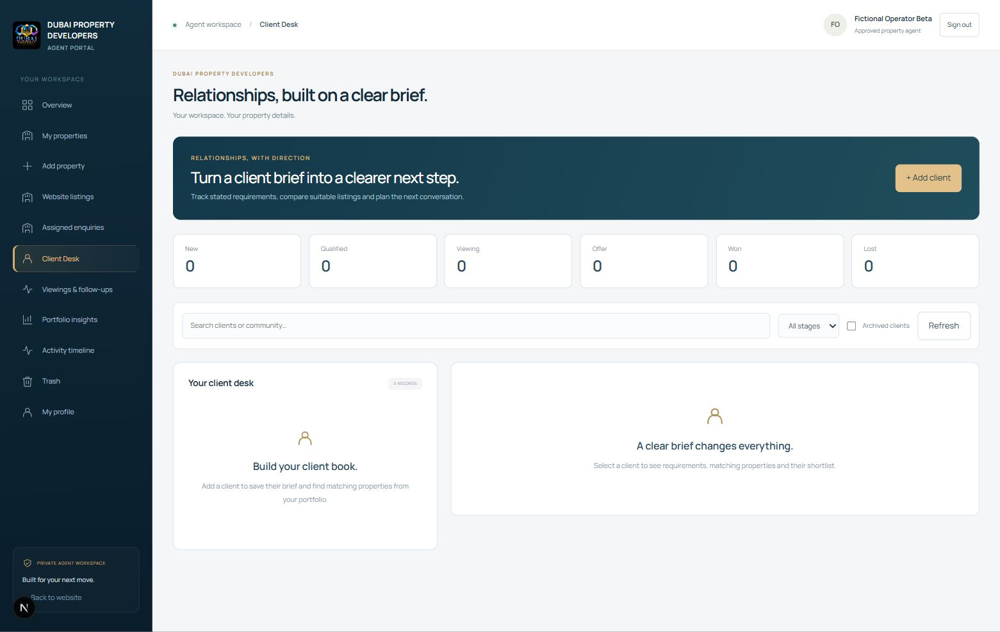

# Local website to operations verification

The fictional enquiry completed the browser journey from anonymous intake to an owned client brief on **24 November 2026**, using revision [`c3f49e8`](https://github.com/shah-hussain-bangash/dubai-property-developers/commit/c3f49e8eb3732e1e8618ea08185503a840b17f9b) in a disposable local environment. This verifies the Next.js enquiry and portal-store handoff. **The complete hosted journey remains unverified; this local result is the portfolio evidence.**

## Traceable result

| Record or check | Observed result |
| --- | --- |
| Website receipt | `DPD-E-99B5F88B` |
| Enquiry ID | `99b5f88b5aa9e70e7212c5b7de32d818` |
| Consent and source | `permission=enquiry`, `source=website`, `page=home` |
| Approved owner | Fictional Operator Alpha, `4f5ff398140cc77bd64912b65469322d` |
| Client brief ID | `4b8e788a4112c7924af1f9521777aec9` |
| Link and ownership | `enquiry.clientId = client.id`; `enquiry.assignedTo = client.agentId` |
| Retained source | The brief notes contain the original enquiry reference and submitted message. Consent remains on the source enquiry. |
| Final state | One enquiry, one brief; enquiry `In progress`, version 3; brief version 1 |
| Other approved operator | Fictional Operator Beta saw zero assigned enquiries and zero client briefs. |

The visitor and both operators were synthetic fixtures. The request described a fictional two-bedroom Dubai Marina apartment requirement with a stated maximum budget of AED 2,500,000; it did not assert actual availability or a property price.





## Checks and environment

- The [pinned main CI run](https://github.com/shah-hussain-bangash/dubai-property-developers/actions/runs/45179343845) reported ten successful jobs.
- Local `ConnectedEnquiries.test.ts` passed 28 tests and `ConnectedEnquiryViews.test.tsx` passed eight tests, both before and after the browser journey: **36 passed, zero failed** in each run.
- Persisted-state assertions checked the IDs, owner, enquiry-only consent, source reference, original message and final record counts.
- All 394 tracked dashboard files matched the pinned Git blob hashes before startup. Next.js subsequently regenerated `next-env.d.ts`; application implementation files remained unchanged.
- The runtime used a separate portal-data directory and loopback-only address. Existing dirty checkouts and their saved data were preserved. CRM, email and WhatsApp delivery were not configured. The runtime was stopped after verification.

[Machine-readable evidence](website-operations-local-2026-11-24.json) includes the synthetic IDs, audit events and screenshot hashes. This is a captured manual browser run with supporting tests, not an automated end-to-end browser test. No application defect required a fix.

## Reproduction steps

Use a fresh disposable local environment at the tested revision. Configure a local Admin and two synthetic member accounts with approved agent access in a separate empty portal-data directory. Do not reuse existing business records.

1. Open `/enquire?interest=Dubai%20Marina%20apartments&source=home`. Enter clearly fictional contact details and requirements, leave the website honeypot empty, and check the enquiry-only contact permission.
2. Submit once and retain the receipt. Confirm the saved enquiry has website source, home context and enquiry-only permission.
3. Sign into Admin and open **Leads & enquiries** at `/enquiries`, rather than the lead-qualification demo. Assign Alpha with the current record version.
4. Sign into Alpha's Agent Portal and open **Assigned enquiries**. Check the receipt, source and permission, then choose **Create client brief**.
5. Review the prefilled notes, enter the stated community, property type and bedroom requirement, and confirm. In **Client Desk**, check the retained receipt/message and authenticated owner.
6. Check the persisted enquiry's client ID against the brief ID and confirm its assigned operator equals the brief owner.
7. Sign into Beta and confirm that both **Assigned enquiries** and **Client Desk** are empty. Sign out and stop the disposable runtime.

Run the focused checks from `apps/dashboard`:

```text
npm test -- src/__tests__/ConnectedEnquiries.test.ts src/__tests__/ConnectedEnquiryViews.test.tsx
```

## Hosted follow-up and portfolio boundary

A subsequent read-only check reached the hosted Admin console. The API identified itself as staging. On 24 November 2026, **Agent management** showed zero registered members, zero approved agents and zero access requests, with the message “No member accounts yet. New agents can register from the website.” Assignment could not proceed without an eligible synthetic operator; no new hosted enquiry, account or approval was created.

The deployed Git revision remains unknown. The release input pinned by the deployment helper does not establish the running revision. A future complete hosted run would require that revision and synthetic operator access. This is optional follow-up for the portfolio; the traceable local result above remains the demonstrated journey. Provider delivery and measured conversion improvements were not verified.
