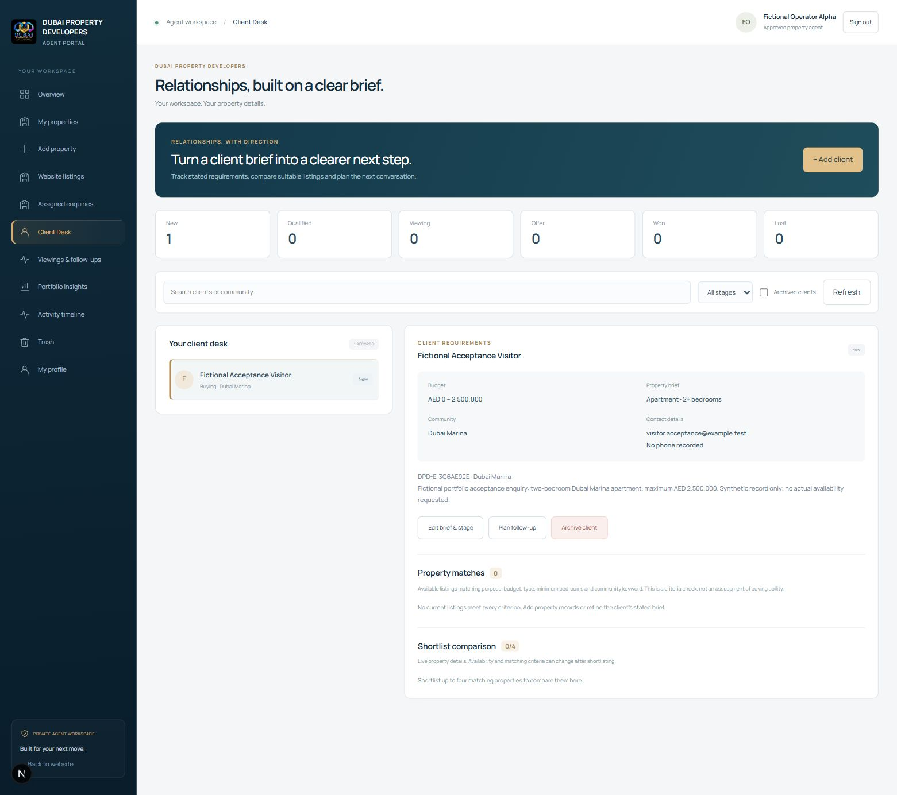
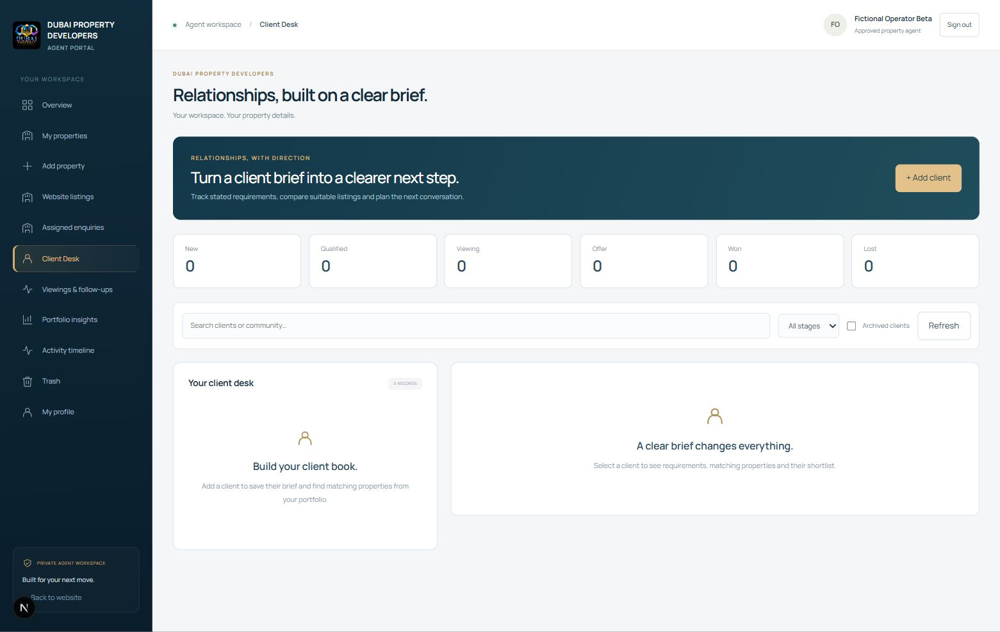

# Candidate website to operations acceptance

On 26 November 2026, the browser journey passed locally at candidate revision
[`0d6f4c4`](https://github.com/shah-hussain-bangash/dubai-property-developers/commit/0d6f4c49d8fa49b75a81a81e33f40343b187f814).
One fictional enquiry retained consent and provenance, was assigned to an approved
operator, and became that operator's owned client brief. A second approved
operator saw neither record. No application blocker required a fix.

This is **disposable local acceptance**, not hosted staging acceptance. The connected
server device reported offline, and opening the hosted Knowledge console timed out.
The hosted public page was readable, but its deployed revision and synthetic
operator access could not be confirmed. No hosted record or account was created.

## Traceable result

| Evidence | Observed result |
| --- | --- |
| Receipt | `DPD-E-3C6AE92E` |
| Enquiry | `3c6ae92e89030590bccd0d2c44a8bdeb` |
| Consent and provenance | `permission=enquiry`, `source=website`, `page=home` |
| Approved owner | Fictional Operator Alpha, `70f1bc63936ec312faa9a7c3bf8c5a99` |
| Client brief | `a37524cbd54bdbe392ac8a328ffc44e4` |
| Linkage | Enquiry client ID equals brief ID; assigned operator equals brief owner |
| Retained source | Brief notes contain the receipt and original enquiry message |
| Final state | One enquiry, version 3, In progress; one brief, version 1 |
| Other operator | Fictional Operator Beta: zero assigned enquiries and zero client briefs |
| External actions | Zero connectors and follow-up tasks; no messaging or CRM configured |

The requirement was a fictional two-bedroom Dubai Marina apartment with maximum
budget AED 2,500,000. It did not assert a live property, availability or buying ability.





[Receipt](assets/acceptance-2026-11-26/01-receipt.jpg) ·
[Admin assignment and consent](assets/acceptance-2026-11-26/02-assigned-enquiry.jpg) ·
[Beta's empty enquiry queue](assets/acceptance-2026-11-26/04-beta-no-enquiries.jpg) ·
[Machine-readable evidence and screenshot hashes](website-operations-local-2026-11-26.json).

## Environment and checks

A separate snapshot used the candidate's 406 tracked dashboard files. Source blob
hashes matched the pinned revision; the generated next-env.d.ts declaration was
obtained from that pinned revision before startup and subsequently regenerated
by Next.js. No application implementation changed during the journey.

The server bound only to `127.0.0.1:3117` with a new private portal-data directory.
Its environment inherited no application credentials. Two fictional member
accounts and their approved access were prepared through local APIs; browser
actions then covered public intake, Admin login/queue/assignment, Alpha login and
conversion, and Beta login/visibility checks. Synthetic credentials were generated
for this run, were not published, and the plaintext fixture was removed afterward.
Previous checkouts and test records were preserved.

The separate FastAPI service was offline; the visible header reported that fact.
This journey uses the Next.js portal routes/store and does not certify backend
agent integrations. The browser was signed out and the disposable server stopped;
a connection attempt afterward was refused.

After the browser run, all **36 focused tests pass** in ConnectedEnquiries.test.ts
and ConnectedEnquiryViews.test.tsx. The candidate's twelve GitHub checks also
passed before this documentation update. These are distinct forms of evidence;
the browser journey itself was performed manually through browser controls.

## Reproduction and remaining dependency

Use the [existing journey reproduction steps](website-operations-local-2026-11-24.md#reproduction-steps)
at the candidate revision with a new empty portal-data directory, a loopback-only
server, a synthetic Admin and two approved fictional operators. Submit one
enquiry-only consent, assign Alpha in Leads & enquiries, create its client brief,
then check both ownership linkage and Beta's empty workspaces. Save the receipt
and actual generated IDs rather than reusing those above. Run:

```text
npm test -- src/__tests__/ConnectedEnquiries.test.ts src/__tests__/ConnectedEnquiryViews.test.tsx
```

Hosted acceptance still requires a verifiable deployed revision and eligible
synthetic operator access. No merge, deployment, live CRM write or customer
communication was performed. The next acceptance group is each agent's supplied
knowledge behavior on the selected revision.
